# EC9 会议报名系统 · 后台管理操作手册

> **适用对象**：运营人员、活动管理员、BD 负责人  
> **文档性质**：后台（PC 管理端）操作说明，每步配界面截图  
> **系统说明**：EC9 管理端登录后，左侧为功能菜单，顶部右侧为语言切换与管理员入口。系统标题沿用升级前的名称「签到系统」（EC9 由 EC8 升级而来），功能模块为完整 EC9 体系。

---

## 0. 登录与界面布局

- **访问地址**：以部署文档为准。线上通常为 `https://ec9.51world.com.cn` 的管理端路径；本机开发态后台一般为 `http://localhost:7098/`。
- 使用管理员账号登录后进入控制台。
- **界面三区**：
  - 左侧：**功能菜单**（控制台 / 活动 / 嘉宾 / 邀约 / 签到 / 场次 / 票种 / 订单 / 支付流水 / 支付配置 / 统计 / BD / 短信 / 操作日志）。
  - 顶部：页面标题 + 右侧 **中 / 繁 / EN 语言切换** + 管理员头像。
  - 主区：当前模块的列表 / 表单 / 操作区。

---

## 1. 控制台（Dashboard）

首页概览，一屏掌握活动全貌。

- **四张统计卡**：活动总数、嘉宾总数、邀约总数、签到总数。
- **近期活动列表**：展示活动名与状态（如「EC9 产品发布会 · 进行中」）。
- **快捷入口**：创建活动、添加嘉宾、发送邀约，点一下直达对应模块。

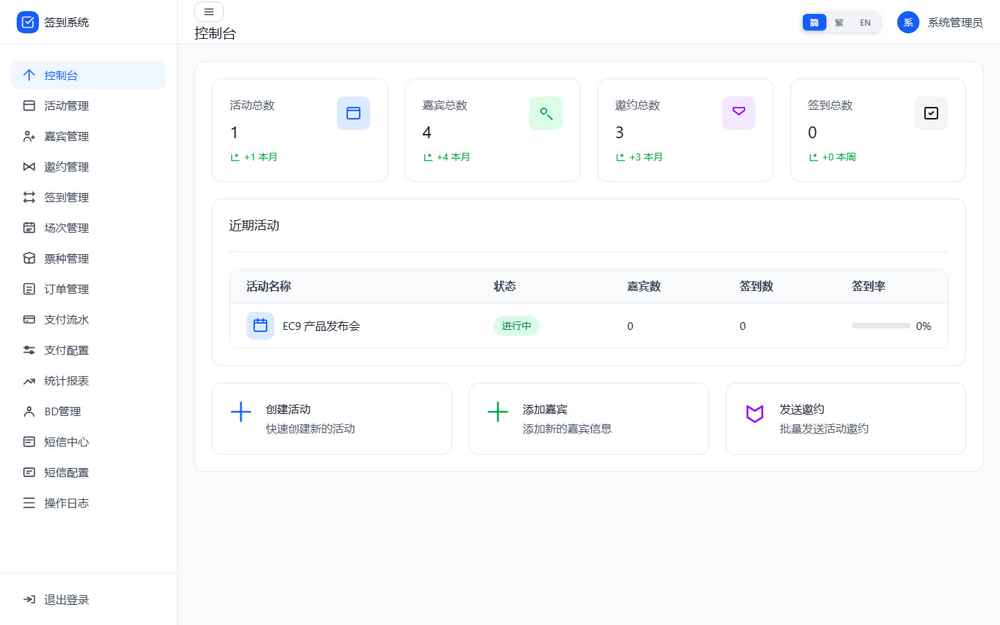

---

## 2. 活动管理

管理会议本身的创建与维护。

- **创建活动**：点左上蓝色「+ 创建活动」按钮，填写名称、日期、地点等。
- **搜索**：右上角搜索框按「活动名称或地点」过滤。
- **行操作**：每条活动右侧有「编辑」「删除」。
- **表格列**：活动名称、日期、地点、状态、嘉宾 / 签到、操作。

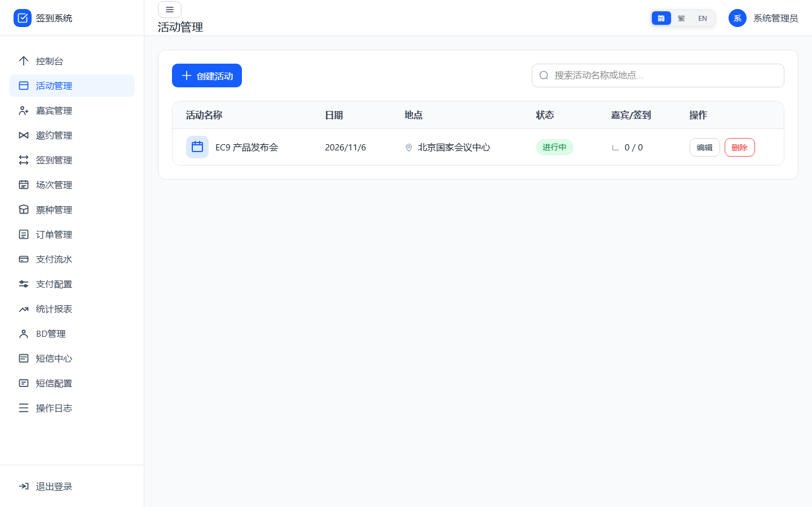

---

## 3. 嘉宾管理

维护参会嘉宾库，可单独添加或批量导入。

- **添加嘉宾**：蓝色「+ 添加嘉宾」。
- **批量导入**：「+ 导入 Excel」，按模板上传。
- **行操作**：编辑、删除。
- **表格列**：姓名、公司、职位、联系方式、BD、标签、操作。

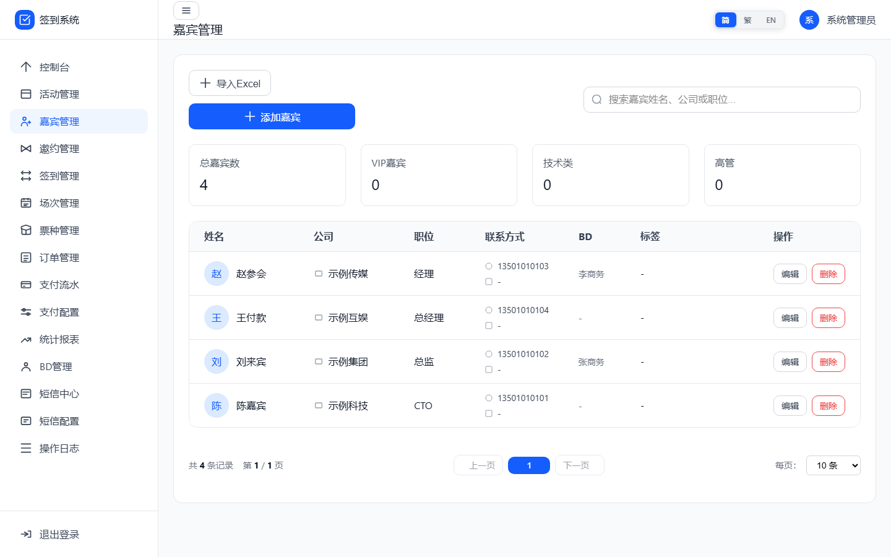

---

## 4. 邀约管理 & 报名审核（重点）

邀约与报名的审批中枢。**参会者提交报名 / 受邀后，在此审核通过，用户才能进入付款环节。**

### 4.1 邀约列表与审批

- **统计卡**：总邀约数、已接受、待回复、**待审批**、已拒绝。
- **操作按钮**：「创建邀约」「批量邀约」「导出 Excel」「签到」。
- **表格列**：勾选、嘉宾姓名、公司、职位、活动名称、BD 联系人、发送时间、状态、操作。
- **单条审批**：待审批记录行内点「**批准**」即通过；也可标记「报名成功」。

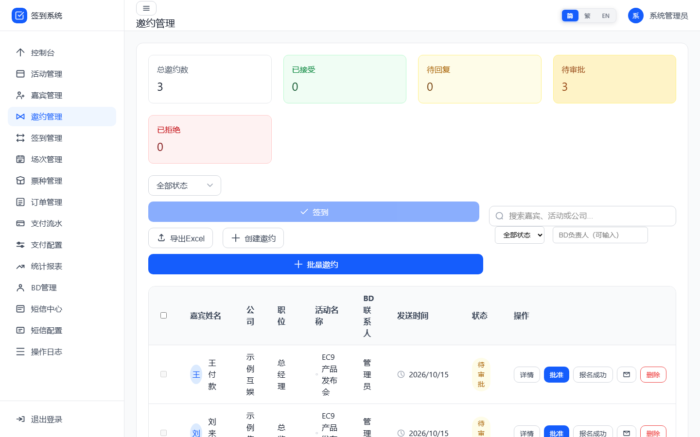

### 4.2 报名审核（多人代报 / 批量）

多人代报、团体报名会进入「报名审核」视图，支持批量处理。

- **表格列**：组号、填报人、购票人手机、票种、人数、状态、提交时间、操作。
- **操作按钮**：「通过」「驳回」，以及「**批量通过**」「**批量驳回**」，支持复选框多选。
- 状态包括：待审核、已支付等。

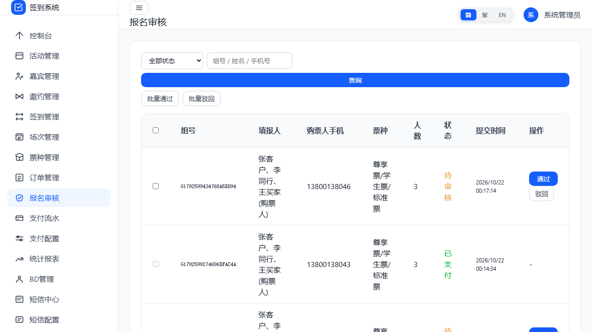

> **流程串联**：参会者在前端提交 → 后台「待审批」→ 管理员「批准 / 通过」→ 用户收到通知去付款 → 支付成功生成电子票。驳回则报名不生效。

---

## 5. 签到管理

现场签到记录与核验。

- **统计卡**：总签到数、今日签到、本周签到、现场签到。
- **签到记录表**：嘉宾姓名、公司、活动名称、签到时间、签到地点、地点类型。
- **搜索**：按嘉宾 / 活动 / 公司过滤。
- **筛选**：「全部活动」下拉。
- **导出**：「导出记录」导出 Excel。
- 下方含「签到时间线」区域，按时间展示签到动态。

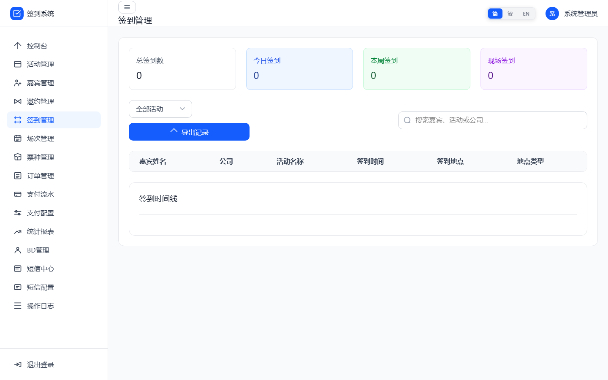

---

## 6. 场次管理

配置会议下的具体场次（如主论坛、分论坛），可设置容量与上下架。

- **新增场次**：「新增场次」按钮。
- **行操作**：编辑、停用 / 启用、删除（已有售出记录的场次不可删）。
- **表格列**：ID、场次名称、开始时间、结束时间、地点、容量、已售、锁定、剩余、状态、排序、操作。
- **容量说明**：容量填 `0` 表示「不限」，剩余栏显示「不限」。

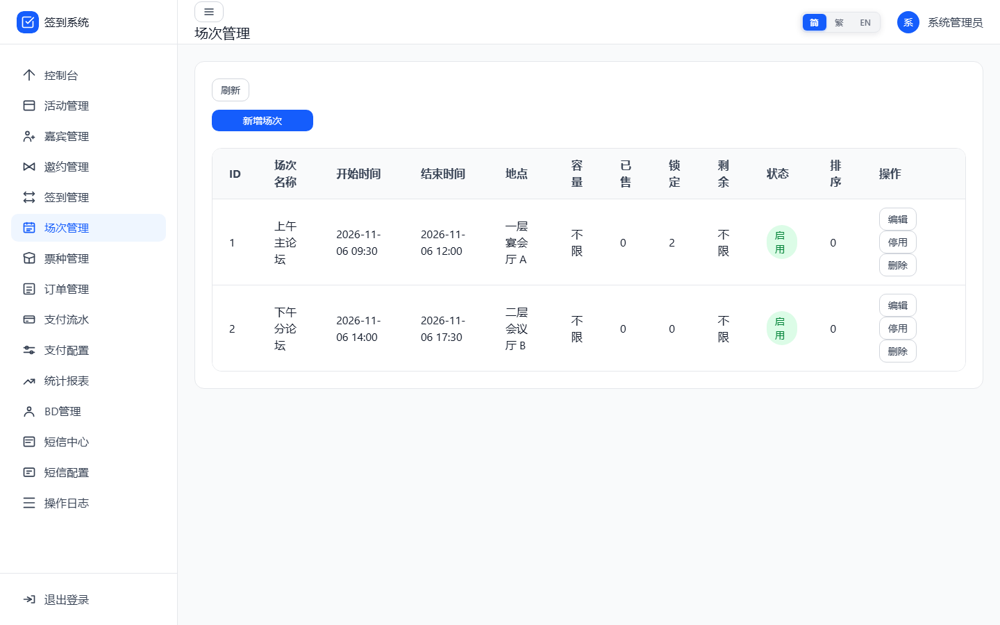

---

## 7. 票种管理

配置对外售卖的票种、价格、库存与折扣属性。

- **新增票种**：「新增票种」。
- **行操作**：编辑、上架 / 下架、调整库存、删除（有售出记录的不可删）。
- **表格列**：ID、票种名称（含适用场次）、价格、总库存、锁定、已售、剩余、售卖截止、状态（上架 / 下架）、折扣、排序、操作。
- **折扣标记**：`is_standard` 票种参与阶梯折扣（如 9 折 / 8 折），具体档位在「折扣规则」中配置；非标准票显示「不参与」。
- **调整库存**：用**增量**（正数加、负数减，0 为不限），不直改总量。

> 票种的价格、库存、折扣均为**实时配置**。改完保存即生效，前端购票页与后台计价同步更新，不影响已下单的历史订单金额。

---

## 8. 订单管理

查看与处理所有报名订单。

- **筛选 / 统计**：按状态、订单号 / 参会人、日期区间过滤；顶部统计卡显示订单总数、已支付、待支付、已支付金额。
- **操作按钮**：「查询」「重置」「导出 CSV」。
- **表格列**：订单号、参会人、票种、场次、数量、金额、状态、下单时间、操作。
- **详情**：点「详情」查看参会人、票种、数量 / 金额、微信交易号、签到码、备注，可保存备注。
- **关闭订单**：待支付订单可「关闭」，释放占用库存，用户无法再支付。
- **刷新微信状态**：详情内可手动同步微信支付状态（订单异常时排查用）。
- **订单状态**：待支付、已支付、已关闭、已退款。

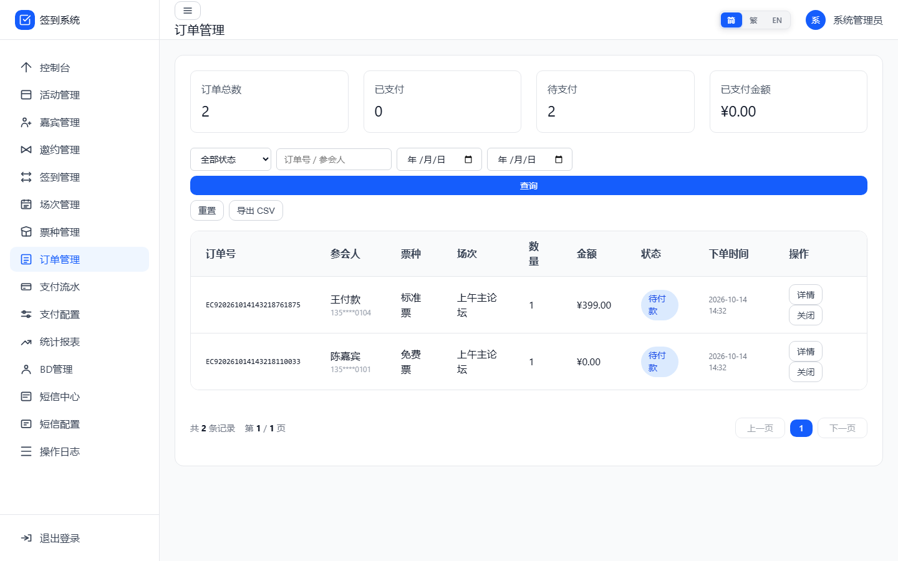

---

## 9. 支付流水

逐笔支付记录与对账。

- **统计卡**：流水总数、成功、成功金额、对账差异。
- **筛选 / 操作**：状态、商户订单号、日期；「查询」「重置」「**对账**」。
- **表格列**：商户单号、参会人、金额、渠道、状态、微信交易号、支付时间、对账、操作。
- **对账**：点「对账」逐笔核对本地流水与订单状态，列表「对账」列标注**一致 / 异常 / 注意**，差异数在统计卡高亮。
- **详情**：可看微信原始回调报文，排障首选。

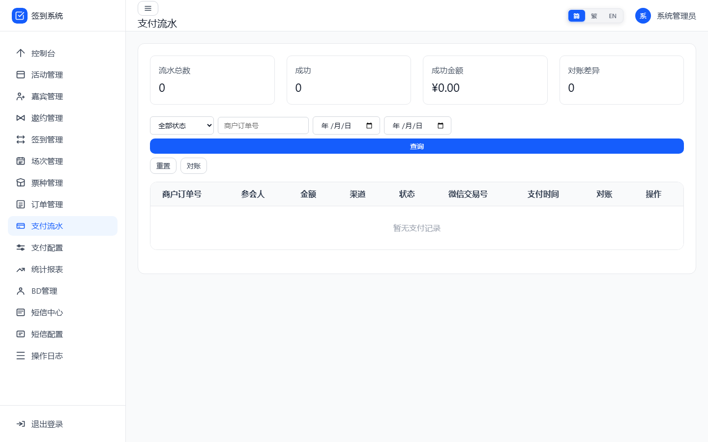

---

## 10. 支付配置

微信支付资质配置，**落库可改、热更新、无需重启服务**。

- **顶部状态卡**：当前模式、配置来源（数据库 / 环境变量）、渠道状态、最近更新。
- **运行模式**：
  - `mock` 模拟（无资质开发，不产生真实交易）
  - `sandbox` 微信沙箱
  - `real` 生产（须填商户号与密钥）
- **关键字段**：公众号 / 小程序 AppID、商户号、API v2 / v3 密钥（对外只显掩码，留空 = 不修改）、签名类型、API 证书路径（仅退款需要）、支付 / 退款回调地址（生产须 https 且外网可达）、订单有效期。
- **保存并生效**：保存后即时生效，并可触发配置自检，列出缺失 / 错误项。

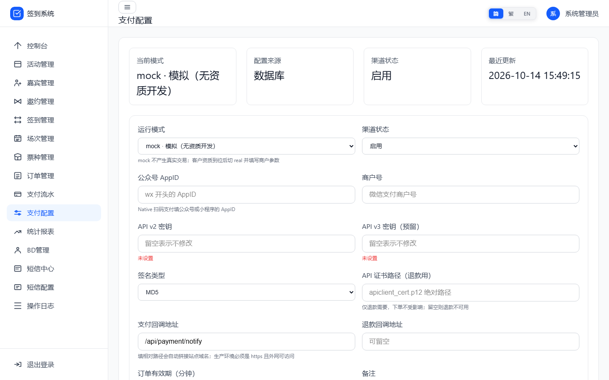

---

## 11. 统计报表

报名数据可视化。

- 当前提供**报名日历统计**：按活动展示每日报名人数，标注「本月总计」。
- **筛选**：「全部活动」下拉 + 月份选择器，「刷新数据」。

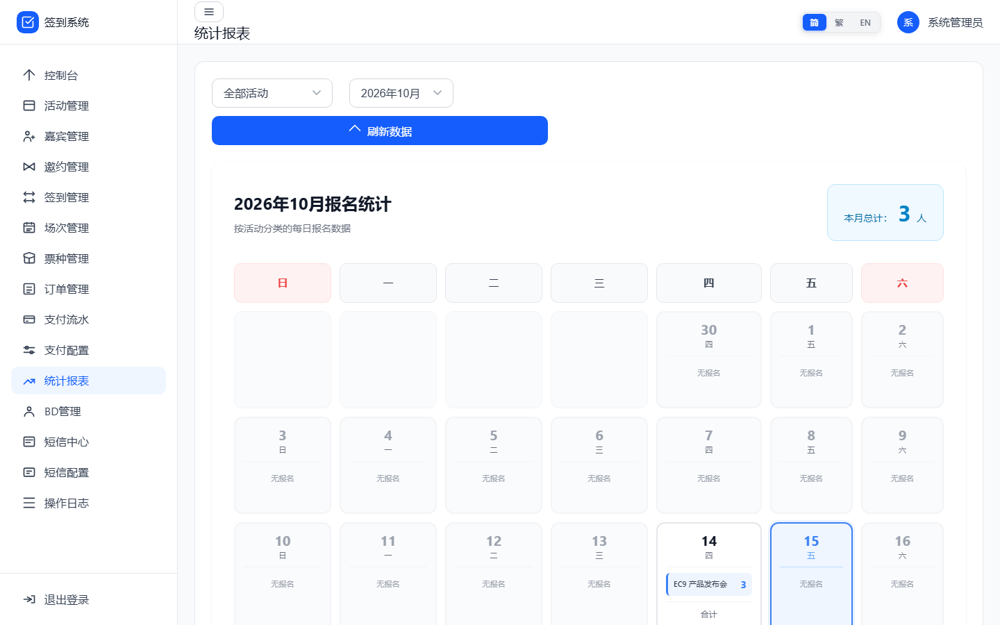

---

## 12. BD 管理

维护 BD（业务拓展）人员账号，用于邀约归属与业绩统计。

- **添加 BD**：「+ 添加 BD」；「+ 导入 BD」批量。
- **搜索**：用户名、姓名、联系方式。
- **行操作**：编辑、删除。
- **表格列**：ID、用户名、姓名、联系方式、角色、状态、最后登录、创建时间、操作。

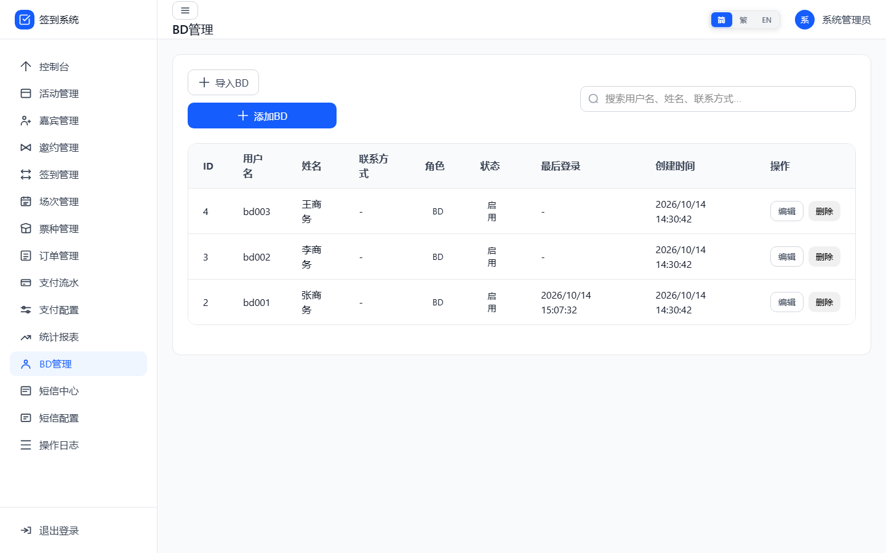

---

## 13. 短信中心

短信模板、规则与发送记录管理。

- **页签**：模板配置、规则配置、发送日志、手动发送。
- **模板表列**：ID、名称、类型（如 checkin_reminder / payment_success）、场景、语言、阿里模板 CODE、签名、启用、操作（编辑 / 删除）。
- **统计卡**：模板数量、规则数量、已发送短信。

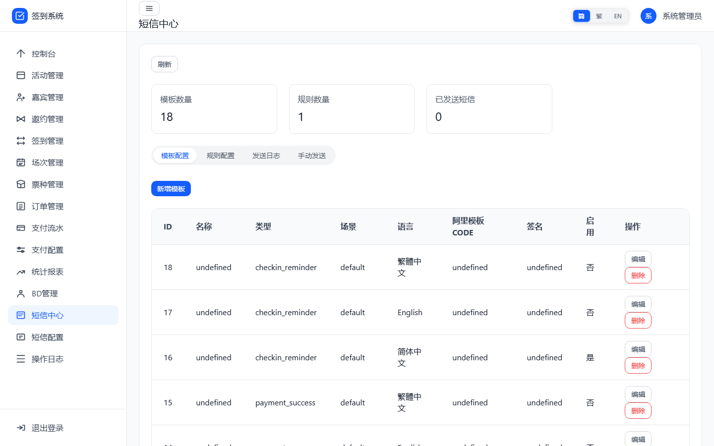

---

## 14. 短信配置

阿里云短信通道参数，**落库可改、热更新**。

- **顶部状态卡**：通道状态、配置来源、短信签名、最近更新。
- **关键字段**：通道状态（启用 / 停用，停用走本地 mock）、地域、AccessKey ID、AccessKey Secret（掩码，留空不修改）、短信签名、验证码模板 CODE、验证码有效期、重发间隔、单号每日上限、最大尝试次数、Endpoint。
- **保存并生效**：保存后即时生效。

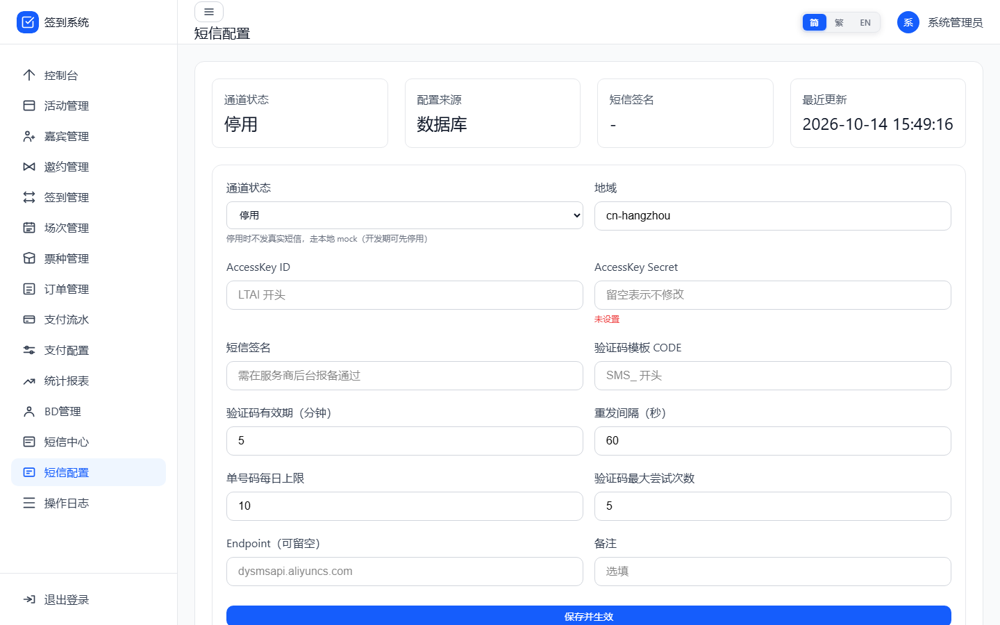

---

## 15. 操作日志

全量操作审计，便于追溯与排障。

- **统计卡**：总操作数、成功操作、失败操作、今日操作。
- **表格列**：操作人、操作动作、操作目标、操作时间、IP 地址、状态。
- **筛选 / 搜索**：「全部操作」下拉 + 搜索框（操作人 / 动作 / 目标）。
- **导出**：「导出日志」。

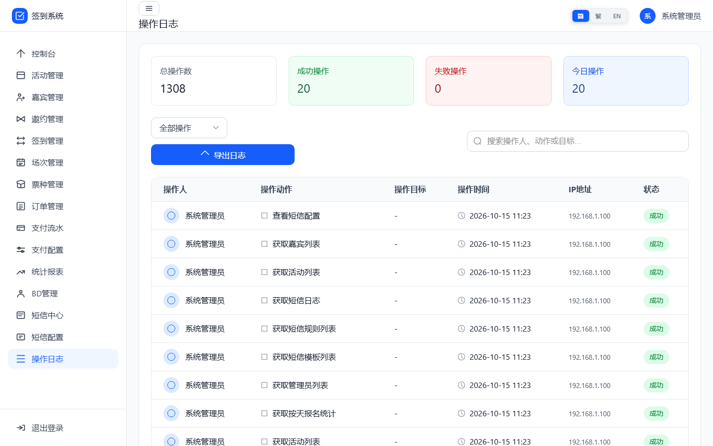

---

## 16. 多语言切换

后台支持 **简体中文 / 繁體中文 / English** 三语，右上角一键切换，全界面即时翻译（含数据多语字段）。

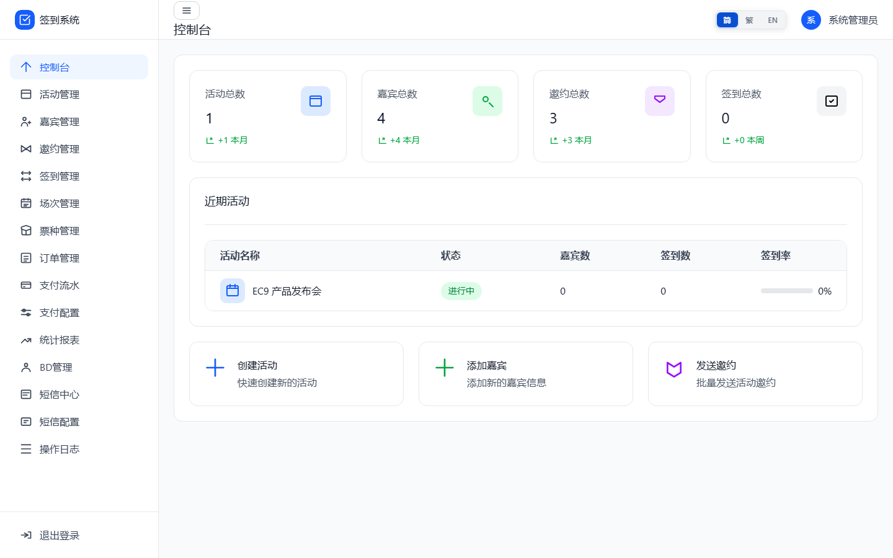
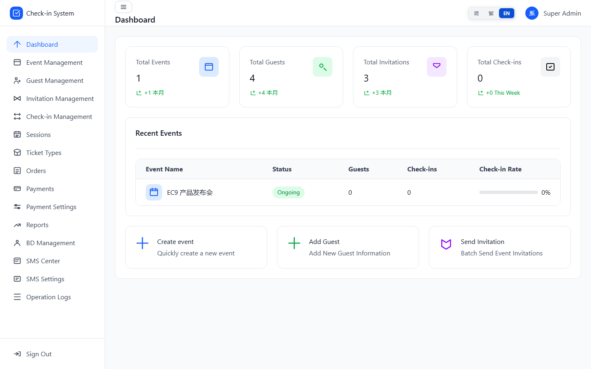
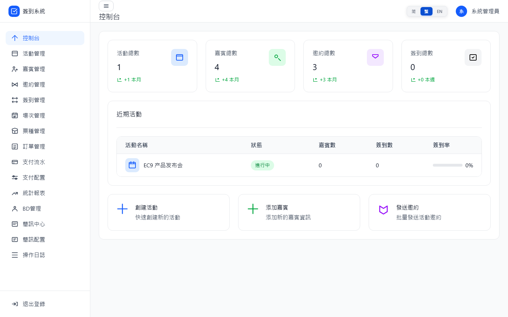

---

## 17. 退出登录

左侧菜单底部「退出登录」退出当前管理员账号。

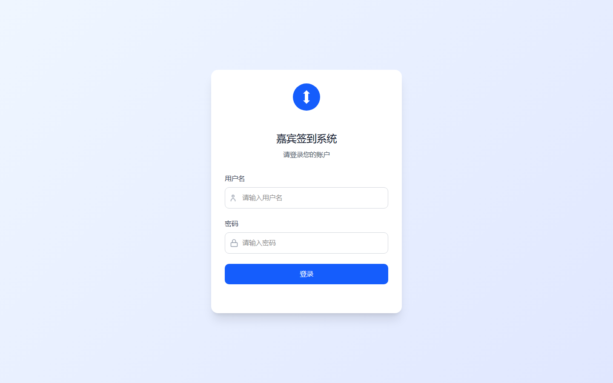

---

## 附录：运营注意事项

1. **审核后付款**：参会者提交 → 后台批准 → 用户付款 → 生成电子票。驳回则不生效。
2. **配置实时生效**：票种价格 / 库存 / 折扣、支付配置、短信配置均落库热更新，**改完无需重启**；但历史订单金额不受影响。
3. **定期对账**：活动期间建议定期在「支付流水」跑一次对账，及时发现金额 / 状态不一致。
4. **库存口径**：场次与票种容量填 `0` 为「不限」；「调整库存」用增量，勿直改总量。
5. **截图说明**：本文档配图取自联调批次（蓝色主题后台），界面与功能以线上最新版本为准；如后续界面更新，替换 `images/` 下同名文件即可，正文无需改动。
