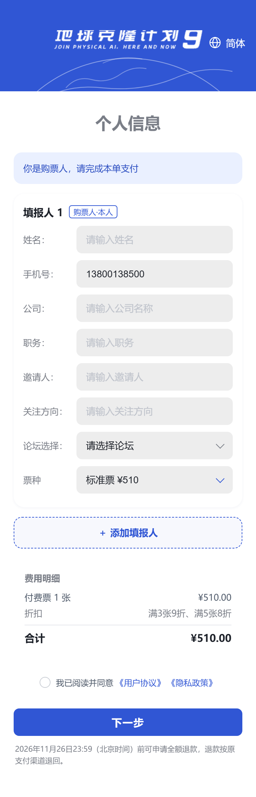
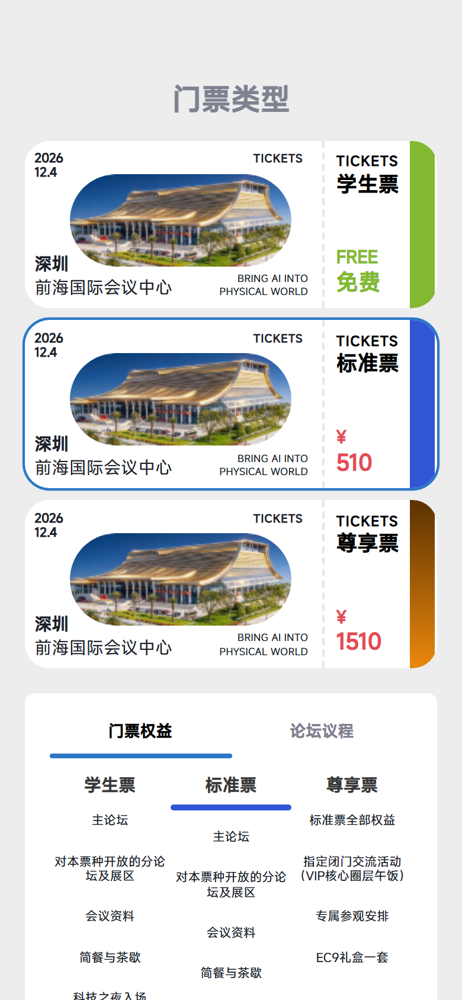
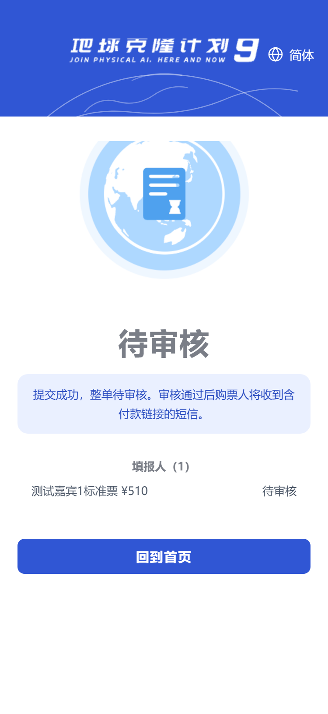
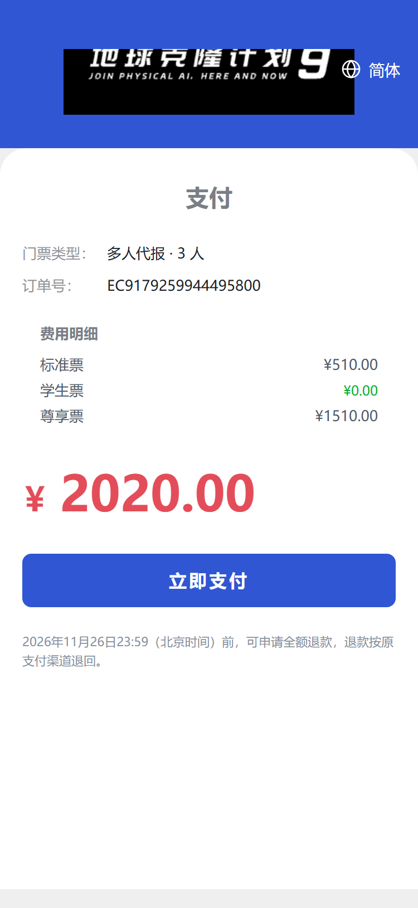
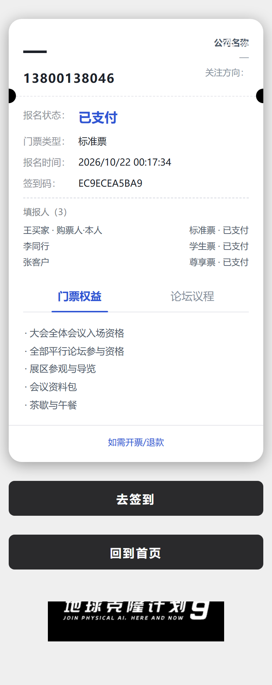
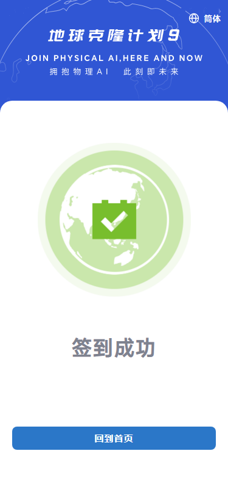
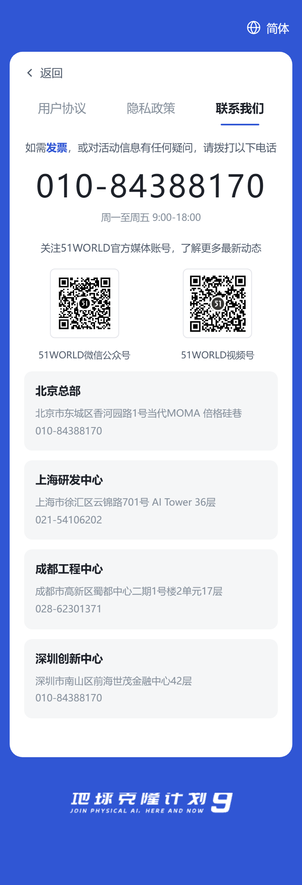
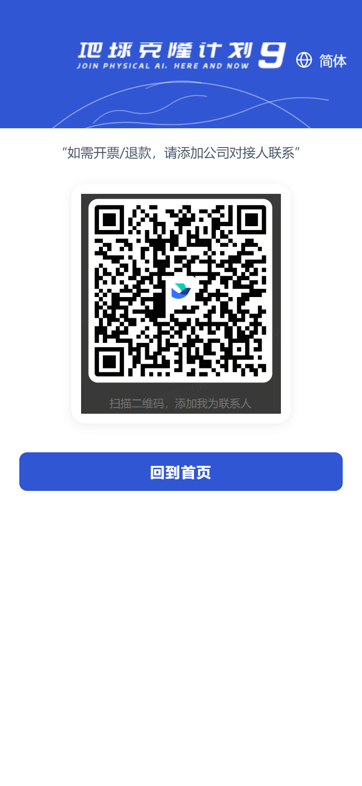

# EC9 会议报名 H5 · 参会者操作指南

> **适用对象**：通过手机微信 / 浏览器报名、购票、签到参会的嘉宾
> **覆盖范围**：会议主页、报名、资料填写、选票购票、审核、支付、电子票、签到、协议与发票、语言切换
> **截图说明**：本文配图取自系统联调批次的真实渲染（蓝色主题），个别视觉细节以线上 / 真机为准；文中票种价格与折扣以主办方实际配置为准。

---

## 一、如何打开这份 H5

整个报名流程都在手机上完成，**无需下载 App**。

- **微信内**：直接点击活动方发来的报名 / 邀约链接；
- **浏览器**：用手机浏览器打开
  `https://ec9.51world.com.cn/h5/ec9/index.html?event_id=1`
- **本机演示环境**：`http://localhost:7098/h5/ec9/index.html?event_id=1`

---

## 二、第一步：浏览会议信息（首页）

首页展示会议名称、时间、地点、股票代码与主题标语。

- 右上角可切换语言（**简体 / 繁體 / EN**，见第九章）；
- 勾选「我已阅读并同意《用户协议》《隐私政策》」；
- 点蓝色斜切按钮 **「立即报名」** 开始报名；
- 或点浅蓝按钮 **「联系我们」** 查看主办方联系方式。

---

## 三、第二步：手机验证（报名信息）

- 输入**手机号** → 点 **「获取验证码」** → 收到短信验证码后填入 → 点 **「下一步」**；
- 验证码 **60 秒**可重发一次；若长时间收不到，请确认手机号无误、信号正常，或联系主办方（演示环境为模拟发送，不会真发短信）；
- 验证通过后会自动带上凭证，进入下一步。

---

## 四、第三步：填写资料 + 选择票种

### 4.1 填写个人信息

按提示填写：

- 姓名、公司、职务、邀请人（选填）、关注方向、论坛 / 场次；
- 带「*」或标红的为必填项。

### 4.2 一人可代多人报名（多人代报）

- 点 **「+ 添加填报人」** 可继续添加同行人（最多 **10 人**，可含本人、可混票种）；
- 每张填报人卡片可单独选票种；也可先点上方票卡**批量套用给所有人**，再单独调整；
- 选**学生票**的成员需填写身份证号（仅用于学籍资格判断，现场核验学生证 / 学籍）。

### 4.3 选择票种（购票页）

- 票种卡片展示价格与权益；点卡片选中，下方 **「门票权益 / 论坛议程」** 可切换查看对比；
- 页面实时显示费用明细与合计；
- 票种示例（**以实际配置为准**）：

  | 票种 | 价格 | 说明 |
  |---|---|---|
  | 学生票 | ¥0 | 现场核验学生证 / 学籍 |
  | 标准票 | ¥510 | 买得多可享折扣，规则见下方 |
  | 尊享票 | ¥1510 | 标准票权益 + VIP 闭门午宴 + 专属参观 + EC9 礼盒 |
  | 嘉宾票 | 定向 | 邀请制，不公开售卖 |

- **折扣口径**：只有**标准票**参与张数折扣，其它票种一律原价；档位与折扣率由后台「折扣规则」配置（后台未配置时回退内置的「满 3 张 9 折 / 满 5 张 8 折」）。

### 4.4 提交

勾选协议 → 点 **「下一步 / 提交」**。系统按**整单**提交，进入主办方审核。

---

## 五、第四步：提交后等待审核（结果页）

- 提交后整单进入 **「待审核」**（一票否决：任一人不通过则整单驳回）；
- 状态包括：**待审核 / 驳回（附原因，可修改后重新提交）/ 审核通过**；
- 审核通过后，**购票人会收到含付款链接的短信**（凭链接免登录即可付款）。

---

## 六、第五步：支付

- 审核通过 → 进入支付页，核对订单金额、票种明细；
- 点 **「立即支付」**：
  - **微信内**：走微信支付；
  - **非微信 / PC**：展示支付二维码，用微信扫码；或点短信里的付款链接免登录支付；
- 支付成功后自动跳转电子票。

---

## 七、第六步：电子票（入场凭证）

- 支付成功即生成电子票，含：持票人信息、门票类型、**签到码**、门票权益 / 论坛议程；
- 点 **「去签到」** 可直达签到；点 **「如需开票 / 退款」** 进入发票页；
- 入场时向工作人员出示签到码（或电子票二维码）。

---

## 八、第七步：现场签到

- 到达会场后，在签到页输入 **「手机号 + 验证码」** 完成签到（与报名验证同一手机号）；
- 签到结果：
  - **成功**：绿色对勾，签到完成；
  - **重复签到**：该手机号已签过；
  - **不匹配**：手机号与报名信息不符，请核对；
  - **网络异常**：请检查网络后重试。

---

## 九、语言切换（简 / 繁 / EN）

- 页面右上角（或顶部地球图标）点一下，选择 **简体 / 繁體 / EN**；
- 切换即时生效，全站文案（含电子票状态词）同步变化；
- 海外嘉宾可直接用 English 版本：

---

## 十、协议与发票

- **用户协议 / 隐私政策 / 联系我们**：首页或各页底部链接进入，三 Tab 切换查看；

  
  
  

- **发票**：电子票页「如需开票 / 退款」→ 发票页展示企业微信二维码，扫码联系开票。

  

---

## 十一、常见问题（FAQ）

- **收不到验证码？**
  确认手机号无误、未欠费停机；60 秒后可重发；仍不行联系主办方（演示环境为模拟发送）。

- **选错票种 / 填错资料？**
  审核通过前可在结果页「重新提交」修改；已支付订单一般不支持直接改，需走退款重报。

- **学生票怎么核验？**
  线上填身份证号做资格判断，现场须出示学生证或有效学籍证明。

- **多人代报怎么操作？**
  见第四章 4.2；购票人本人手机锁定，可添加最多 9 名同行人，票种可混选。

- **支付失败 / 超时？**
  订单超时自动关闭并释放库存；重新进入支付页会复用或新建订单。

- **签到码在哪？**
  电子票页「签到码」一栏，或电子票二维码。

- **支持哪些票种 / 折扣？**
  见第四章 4.3；折扣仅标准票参与，规则以后台「折扣规则」为准。

---

## 附录：票务速览

| 票种 | 价格 | 说明 |
|---|---|---|
| 学生票 | ¥0 | 现场核验学生证 / 学籍 |
| 标准票 | ¥510 | 可享张数折扣（后台配置） |
| 尊享票 | ¥1510 | 标准票权益 + VIP 午宴 + 专属参观 + 礼盒 |
| 嘉宾票 | 定向 | 邀请制，不公开售卖 |

**退款政策要点**：2026 年 11 月 26 日 23:59（北京时间）前可申请全额退款，按原支付渠道退回（具体以页面退款提示为准）。
